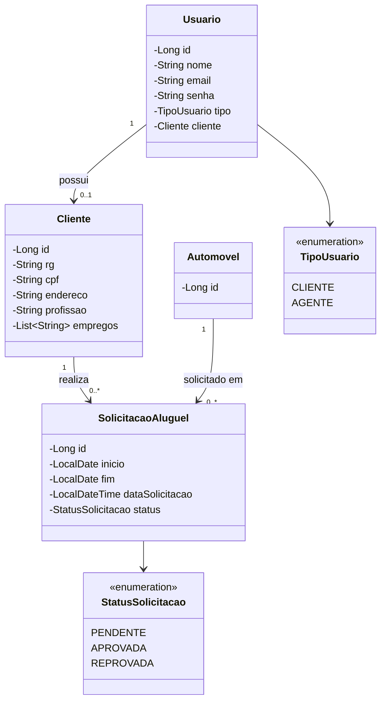

# 🚗 AluguelCars

Sistema web para gerenciamento de aluguel de automóveis, permitindo que clientes realizem solicitações de aluguel e agentes gerenciem, analisem e aprovem ou reprovem os pedidos.

<p align="center">
  
  
  
  
</p>

---

## 📝 Sobre o Projeto

O **AluguelCars** é uma aplicação web desenvolvida para facilitar o processo de solicitação e gerenciamento de aluguel de automóveis.

O sistema possui dois tipos de usuários: **CLIENTE** e **AGENTE**. Os clientes podem realizar seu cadastro, informar seus dados pessoais e solicitar o aluguel de automóveis. Já os agentes possuem acesso às funcionalidades administrativas, podendo consultar clientes, visualizar solicitações e avaliar os pedidos, aprovando ou reprovando cada solicitação.

O projeto foi desenvolvido como aplicação Full Stack, utilizando React no Front-end e Java com Spring Boot no Back-end, com comunicação por meio de uma API REST.

## ✨ Funcionalidades Principais

### 🔐 Autenticação e Usuários
- Cadastro de usuários.
- Login com autenticação JWT.
- Diferenciação entre os perfis CLIENTE e AGENTE.
- Controle de acesso conforme o tipo de usuário.
- Proteção de rotas no Front-end.

### 👤 Área do Cliente
- Cadastro de dados pessoais.
- Consulta dos próprios dados.
- Visualização das solicitações realizadas.
- Criação de solicitações de aluguel.
- Acompanhamento do status dos pedidos.

### 🚘 Gerenciamento de Automóveis
- Cadastro de automóveis.
- Consulta dos automóveis disponíveis.
- Atualização dos dados dos automóveis.
- Exclusão de automóveis.

### 📋 Gerenciamento de Solicitações
- Criação de solicitações de aluguel.
- Definição das datas de retirada e devolução.
- Consulta das solicitações realizadas.
- Visualização dos pedidos pelos agentes.
- Aprovação ou reprovação de solicitações.
- Cancelamento de solicitações.

### 🧑‍💼 Área do Agente
- Consulta de clientes cadastrados.
- Gerenciamento de automóveis.
- Visualização de todas as solicitações.
- Avaliação e alteração do status dos pedidos.

---

## 🛠 Tecnologias Utilizadas

### 💻 Front-end
- **React:** construção da interface da aplicação.
- **JavaScript:** implementação da lógica da aplicação.
- **Vite:** ferramenta de desenvolvimento e build.
- **React Router DOM:** gerenciamento de rotas e navegação.
- **CSS:** estilização das interfaces.
- **Fetch API:** comunicação com o Back-end.

### 🖥️ Back-end
- **Java 17:** linguagem de programação.
- **Spring Boot:** desenvolvimento da API REST.
- **Spring Security:** autenticação e autorização.
- **JWT:** geração e validação de tokens de autenticação.
- **Spring Data JPA:** persistência e consulta de dados.
- **Hibernate:** mapeamento objeto-relacional.

### 🗄️ Banco de Dados
- Banco de dados relacional integrado ao Back-end por meio do Spring Data JPA.

---

## 🏗 Arquitetura

O projeto utiliza uma arquitetura Full Stack dividida em duas aplicações principais:

- **Front-end:** responsável pela interface, navegação, interação com o usuário e consumo da API.
- **Back-end:** responsável pelas regras de negócio, autenticação, autorização e persistência dos dados.

A comunicação entre as aplicações acontece por meio de requisições HTTP utilizando uma API REST.

### Organização do Back-end

O Back-end segue uma organização em camadas:

| Camada | Responsabilidade |
|---|---|
| Controller | Recebe as requisições HTTP e disponibiliza os endpoints da API. |
| Service | Implementa as regras de negócio da aplicação. |
| Repository | Realiza operações de persistência e consulta no banco de dados. |
| Entity | Representa as entidades persistidas no banco de dados. |
| Security | Gerencia autenticação, autorização e validação dos tokens JWT. |

### Fluxo de Comunicação

1. O usuário interage com a interface React.
2. O Front-end realiza uma requisição HTTP para a API.
3. O Back-end recebe a requisição pelo Controller.
4. O Service executa as regras de negócio.
5. O Repository realiza as operações necessárias no banco de dados.
6. O Back-end retorna a resposta para o Front-end.
7. O React atualiza a interface conforme o resultado recebido.

### 🔑 Autenticação e Autorização

A autenticação é realizada por meio de JWT (JSON Web Token).

Após o login, o Back-end retorna um token que é armazenado no navegador pelo Front-end. Nas requisições protegidas, o token é enviado no cabeçalho `Authorization`, permitindo que o Back-end identifique o usuário e verifique suas permissões.

O sistema diferencia dois perfis:

- **CLIENTE:** acesso às funcionalidades relacionadas aos próprios dados e solicitações.
- **AGENTE:** acesso às funcionalidades administrativas, incluindo gerenciamento de clientes, automóveis e avaliação de solicitações.

---

## 📊 Diagrama UML

O diagrama abaixo representa as principais entidades do domínio da aplicação e seus relacionamentos.



---

## 🔧 Instalação e Execução

### Pré-requisitos

Antes de executar o projeto, certifique-se de possuir:

- **Java JDK 17** ou superior.
- **Node.js** versão LTS.
- **npm**.
- **Git**.
- Banco de dados configurado conforme as propriedades do Back-end.

### 1. Clonar o Repositório

```bash
git clone https://github.com/MateusRibasMarques/AluguelCars.git
```

Acesse a pasta do projeto:

```bash
cd AluguelCars
```

### 2. Executar o Back-end

Acesse a pasta do Back-end:

```bash
cd Back_end.demo
```

Execute a aplicação utilizando o Maven Wrapper, caso esteja disponível:

**Windows:**

```bash
mvnw.cmd spring-boot:run
```

**Linux/macOS:**

```bash
./mvnw spring-boot:run
```

O Back-end será iniciado na porta `8080`, conforme a configuração da aplicação.

### 3. Executar o Front-end

Abra outro terminal e acesse a pasta do Front-end:

```bash
cd front-end
```

Instale as dependências:

```bash
npm install
```

Inicie o servidor de desenvolvimento:

```bash
npm run dev
```

O Front-end será disponibilizado pelo Vite, normalmente em:

```text
http://localhost:5173
```

---

## 📂 Estrutura do Projeto

```text
AluguelCars/
│
├── Back_end.demo/
│   ├── src/
│   │   ├── main/
│   │   │   ├── java/
│   │   │   │   └── ...
│   │   │   │       ├── controller/
│   │   │   │       ├── service/
│   │   │   │       ├── repository/
│   │   │   │       ├── model/
│   │   │   │       └── security/
│   │   │   │
│   │   │   └── resources/
│   │   │       └── application.properties
│   │   │
│   │   └── test/
│   │
│   └── pom.xml
│
├── front-end/
│   ├── public/
│   ├── src/
│   │   ├── components/
│   │   ├── pages/
│   │   ├── services/
│   │   ├── assets/
│   │   └── ...
│   │
│   ├── package.json
│   └── vite.config.js
│
└── README.md
```

---

## 🧪 Testes e Validações

Durante o desenvolvimento, foram realizados testes manuais dos principais fluxos da aplicação:

- Cadastro de usuários com diferentes perfis.
- Autenticação de clientes e agentes.
- Cadastro de dados pessoais do cliente.
- Criação de solicitações de aluguel.
- Consulta de solicitações pelo cliente.
- Consulta de solicitações pelo agente.
- Aprovação de solicitações.
- Reprovação de solicitações.
- Atualização e visualização dos status dos pedidos.
- Controle de acesso conforme o perfil autenticado.

---

## 🔮 Melhorias Futuras

- Implementação de recuperação de senha.
- Aprimoramento das validações dos formulários.
- Implementação de testes automatizados.
- Melhorias na experiência e responsividade da interface.
- Implementação de relatórios de solicitações.
- Aprimoramento do gerenciamento de disponibilidade dos automóveis.

---

## 👨‍💻 Autor

**Mateus Marcal Ribas Marques**

Estudante de Engenharia de Software.

- GitHub: [MateusRibasMarques](https://github.com/MateusRibasMarques)
- Repositório: [AluguelCars](https://github.com/MateusRibasMarques/AluguelCars)

---

<p align="center">
  Desenvolvido como projeto de estudo em Engenharia de Software.
</p>
